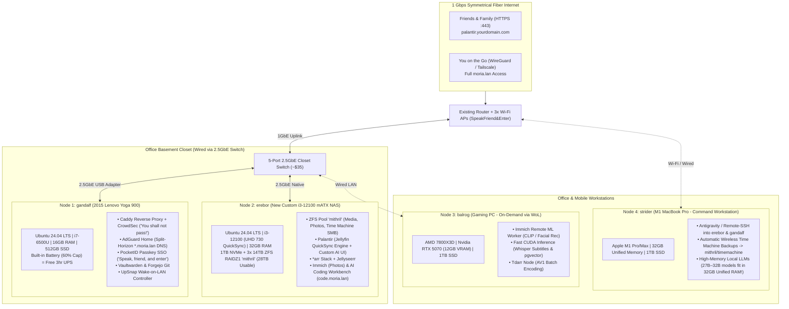
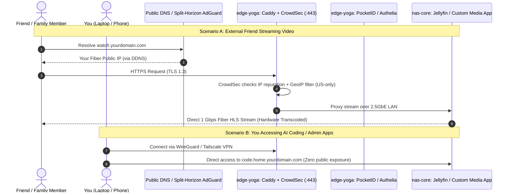
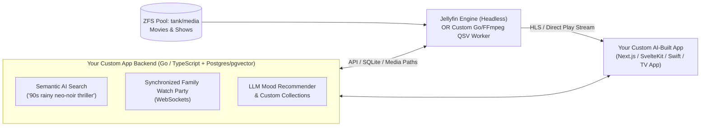
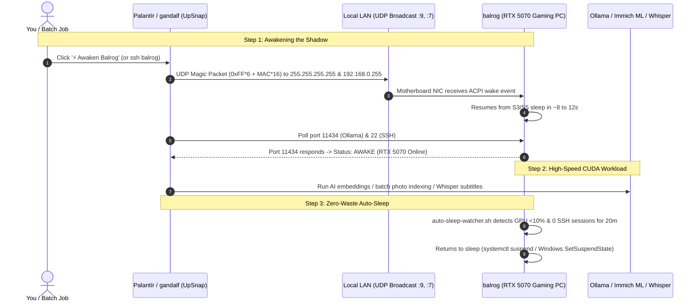

# Moria Homelab (`*.moria.lan`), 28TB `mithril` NAS & AI App Server Blueprint

## 1. High-Level System Topology (`SpeakFriend&Enter`)

With your **M1 MacBook Pro (32GB Unified Memory)** added in, your hardware forms a **4-node Lord of the Rings ecosystem** where every machine plays to its unique physical strengths:



### Why This 4-Node Split Works So Well
1. **`gandalf` (Lenovo Yoga 900) — Zero Single Point of Failure**: Because the Yoga 900 has an internal battery (capped at 60% via Ubuntu's `ideapad_acpi` driver), putting **DNS (AdGuard Home), Reverse Proxy (Caddy), Passwords (Vaultwarden), and Git (Forgejo)** on it means you can reboot `erebor` or survive a brief power outage without taking down household internet.
2. **`erebor` (Custom i3-12100 NAS) — 28TB `mithril` Storage & 4K QuickSync**: The Intel i3-12100's **UHD 730 QuickSync** engine simultaneously hardware-transcodes multiple 4K HDR10 streams for external friends/family at under 15W of CPU power, while serving your 28TB ZFS pool and running 24/7 AI coding containers on the 1TB NVMe drive.
3. **`balrog` (7800X3D + RTX 5070) — Zero Idle Power Waste**: Sleeps when you aren't gaming. When a batch job needs CUDA speed (indexing 50,000 photos in Immich or generating subtitles via Whisper), `gandalf` sends a Wake-on-LAN magic packet, `balrog` wakes up, crunches the queue, and goes back to sleep.
4. **`strider` (M1 MacBook Pro w/ 32GB Unified Memory) — The Hidden AI Advantage**: While the RTX 5070 has fast CUDA cores, its 12GB VRAM cap limits model size. Your M1 MacBook Pro's **32GB Unified Memory** can allocate ~24GB directly to Apple Metal—meaning it can run larger **27B–32B parameter local coding/reasoning models** via Ollama when needed, while backing itself up automatically over Wi-Fi to `mithril/timemachine` on `erebor`.

---

## 2. `erebor` Hardware Bill of Materials (BOM)

### Option A (Top Recommended Build — ~$310 to $450): Dell Precision 3630 Mid-Tower + ZFS Storage
The **Dell Precision 3630 Mid-Tower** is the top-recommended hardware platform for `erebor`. Compared to small form factor (SFF) office desktops, the Precision 3630 provides **3 native 3.5" tool-less drive bays**, a **dedicated slim optical bay for automated DVD ripping**, **2 onboard M.2 NVMe slots**, 4 native SATA ports, and an efficient 300W–460W Gold power supply that easily handles spinning enterprise hard drives without proprietary power splitters.

*(Note: If you prefer local Utah pickup in Provo, the **BYU Surplus Dell OptiPlex 7070 SFF ($145)** remains an excellent compact alternative).*

| Component | Recommended Part & Source | Est. Price | Why This Part |
| :--- | :--- | :--- | :--- |
| **Base Server (`erebor`)** | **eBay [Dell Precision 3630 Tower](https://www.ebay.com/sch/i.html?_nkw=Dell+Precision+3630+Tower&LH_BIN=1&_sop=15)** (Core `i5-8500` or `i5-9500`, 8GB–16GB RAM, 256GB SSD) | **~$150 – $175** *(Shipped)* | 6-core Intel CPU with **Intel UHD 630 QuickSync** (3–4x 4K HDR streams in hardware at ~12W idle), 3 native 3.5" drive caddies, 2x M.2 NVMe slots, 4x DDR4 slots, and 4 native SATA ports. |
| **Hard Drives (`mithril`)** *(Choose 1 Path)* | **Path 1 (Redundant Mirror):** 2x 8TB ($140–$160) or 2x 10TB ($190–$220) SATA Enterprise CMR<br>**Path 2 (Single Big Drive):** 1x 14TB SATA Enterprise CMR ($250–$300) | **~$140 – $280** | **Path 1** provides immediate 1-drive fault tolerance (~7.3 TiB or ~9.1 TiB usable).<br>**Path 2** maximizes day-one capacity (~12.7 TiB usable) while keeping cash outlay low; convert to mirror anytime via `zpool attach`. |
| **Optical Ripper Drive** | **Internal Slim 9.5mm DVD/CD-RW Drive** (fitted in 3630 front bay) or **LG Portable USB (`GP65NB60`)** | **$18 – $22** | Dedicated to **100% automated DVD/CD ripping** via `arm-ripper` (`rip.moria.lan`)—insert disc, auto-transcode via QuickSync to H.265 into `mithril/media/movies`, and auto-eject. |
| **RAM *(Included or Upgraded)* ** | 8GB–16GB DDR4 (Included) *(Optional 2x8GB kit to reach 24GB–32GB)* | **$0 today** *(+$25 later)* | Included 8GB–16GB runs Ubuntu Server, ZFS, Jellyfin, and all Docker containers on day one. |
| **Total (Dell Precision 3630 Build)** | | **~$310 – ~$475** *(Depending on HDD choice)* | **Saves $500–$680** vs. a custom DIY build while delivering 3 native drive bays, native optical ripping, 4K QuickSync, and ZFS data integrity. |

---

### How the $145 OptiPlex 7070 Compares to More Expensive Options ($250–$995)

When comparing the **$145 BYU Surplus OptiPlex 7070 (`i5-9500`)** against pricier **$220–$350 eBay listings** (such as `i7-9700` / 10th–11th Gen OptiPlex 7080/7090 towers, or pre-upgraded 16GB/32GB/1TB SSD configs) and the **$995 custom mATX build**:

| Feature / Workload | **$145 BYU Surplus OptiPlex 7070 (`i5-9500`, 8GB, 256GB)** | **$230–$350 Pricier eBay Desktop (`i7-9700` / `i5-10500`, 16–32GB, 512GB–1TB)** | **$995 Custom mATX Build (`i3-12100`, 32GB, Jonsbo N4)** |
| :--- | :--- | :--- | :--- |
| **4K Jellyfin / `Palantír` Transcoding** | **Identical** (Intel UHD 630 QuickSync handles 3–4x 4K HDR10 streams in hardware) | **Identical** (`i7-9700` & 10th-Gen `i5-10500` use the **exact same UHD 630 QuickSync silicon**) | **Slightly newer** (UHD 730 adds AV1 decode, but same H.264/HEVC output for Fire Tablets & TVs) |
| **Heavy AI / ML Jobs (Immich, Whisper)** | Offloaded to **`balrog` (RTX 5070)** & **`strider` (M1 32GB)** anyway | Zero real-world difference because `balrog`'s RTX 5070 is 30x faster than any CPU | Zero real-world difference |
| **RAM & SSD Value** | Cheaper to buy a $25 16GB DDR4 kit yourself than pay an eBay reseller a $100+ markup | Often charges $100–$150 extra for $30 worth of RAM/SSD upgrades | Brand-new parts, 4x DIMM slots |
| **3.5" Hard Drive Capacity** | **1–2x 3.5" HDDs** (SFF) or **2–3x 3.5" HDDs** (Tower/MT) → up to **14TB–28TB usable** | **1–3x 3.5" HDDs** (same Dell chassis limitations) | **6–10x 3.5" HDD bays** for massive future multi-vdev arrays |
| **Shipping & Return Risk** | **$0 local pickup in Provo** + backed by BYU Surplus | Often $25–$45 shipping or baked into price | Free shipping on new retail parts |

> [!TIP]
> **Bottom Line on Pricier eBay OptiPlexes ($220–$350):** Third-party eBay refurbishers routinely charge **$100–$150 extra** just for bumping an OptiPlex from 8GB to 16GB/32GB RAM or swapping in an `i7-9700` or 10th-gen `i5-10500`. Because Intel 7th, 8th, 9th, and 10th Gen CPUs all share the **exact same UHD 630 QuickSync media engine**, and because your heavy AI workloads already run on **`balrog` (RTX 5070)** and **`strider` (M1 MacBook Pro)**, paying extra for a pricier eBay desktop buys you almost zero noticeable performance for `erebor`. Grab the **$145 BYU Surplus 7070** locally and spend the money you saved on hard drives!

---

### Option B (Maximum Expansion DIY Build — ~$995): Custom i3-12100 mATX NAS

If you ever outgrow 2 hard drives and want a 6-to-10-bay hot-swap NAS case with 2.5GbE and PCIe HBA expansion:

| Component | Recommended Part | Est. Price | Why This Part |
| :--- | :--- | :--- | :--- |
| **CPU** | Intel Core i3-12100 or i3-13100 *(Ensure non-"F" model!)* | $115 | 4P cores / 8 threads, includes **UHD 730 iGPU** (QuickSync for 4K transcoding), idles at ~10W. *(Never buy the "F" suffix CPU, which lacks the iGPU).* |
| **Motherboard** | ASRock B760M Pro RS/D4 WiFi (mATX) | $125 | Built-in **2.5GbE NIC**, 4x DDR4 slots, 2x M.2 NVMe slots, 4x native SATA ports + extra PCIe slots. |
| **RAM** | 32GB (2x16GB) DDR4-3200 CL16 | $55 | Leaves 2 empty DIMM slots to upgrade to 64GB later; feeds ZFS ARC cache + AI dev containers. |
| **Case** | **Jonsbo N4** (6-bay hot-swap mATX) or **Fractal Node 804** (10-bay mATX) | $115 | Jonsbo N4 gives you a compact 6-bay hot-swap SATA backplane; Node 804 gives massive airflow and room for 8–10 HDDs. |
| **Power Supply** | Corsair SF450 (SFX for Jonsbo N4) or MSI MAG A550BN / Corsair CX550 (ATX for Node 804) | $65 | Match SFX (Jonsbo N4) or standard ATX (Node 804) to your chosen case. |
| **OS & App SSD** | 1TB Gen4 NVMe M.2 (WD Black SN770 or Crucial P3 Plus) | $65 | Holds Linux OS, Docker volumes, Postgres DBs, Jellyfin metadata cache, and AI workspaces. |
| **Hard Drives (x3)** | **3x 14TB** Seagate Exos X16/X18 or WD Ultrastar HC530 (Manufacturer Recertified, ServerPartDeals / GoHardDrive) | $345 *(~$115 ea)* | Enterprise helium CMR drives. **3x 14TB in ZFS RAIDZ1 = 28TB usable** with 1-drive fault tolerance and 1 free SATA port to spare. |
| **Closet Networking** | 5-Port 2.5GbE Unmanaged Switch + RTL8156B USB-to-2.5GbE Adapter (for Yoga 900) | $45 | Connects `nas-core` and `edge-yoga` at 2.5 Gbps in the closet using your single wall Ethernet drop. |
| **UPS Protection** | APC / CyberPower 600VA–850VA UPS (with USB data port) | $65 | **Critical for ZFS**: triggers clean shutdown via `nut` (Network UPS Tools) if power stays out. |
| **Total** | | **~$995** | **28TB usable ZFS storage + 1TB NVMe + 32GB RAM + 4K QuickSync + 2.5GbE + UPS** |

---

## 3. OS & Orchestration Architecture: Maximum Performance

You mentioned wanting the **best performance** and being open to any stack with AI assistance. Here is the engineering comparison for your specific 3-node topology:

### Winner: Bare-Metal Debian 12 (or Ubuntu 24.04 LTS) + Native ZFS + Docker Engine + Komodo (GitOps)

Why **Bare-Metal Linux + Docker Compose (via Komodo)** beats Proxmox and Kubernetes (K3s) for this setup:
1. **Zero Hypervisor / Memory Tax**: In Proxmox, you have to statically partition your 32GB RAM between a NAS VM and a Docker VM, or deal with LXC mount permission headaches for ZFS + `/dev/dri`. On bare-metal Debian with OpenZFS, Linux dynamically gives all unused RAM to the **ZFS ARC cache** and instantly releases it when a Docker container or AI coding build spikes in memory.
2. **Simultaneous GPU Sharing (`/dev/dri`)**: Multiple Docker containers (Jellyfin, your custom Plex-like app, Immich, Frigate) can simultaneously access `/dev/dri/renderD128` (Intel QuickSync) without exclusive PCIe passthrough locks.
3. **Why Not K3s Across the 3 Nodes?**:
   - Kubernetes excels when nodes are interchangeable ("cattle"). Your 3 nodes are highly specialized: `nas-core` holds 28TB of physical disks and QuickSync; `edge-yoga` has a battery and a 2-core 2015 CPU; `gpu-beast` is powered off 75% of the day.
   - K3s control-plane `etcd` writes + CNI overlay networking consume ~1.5–2GB RAM and constant background CPU/disk I/O on the 2-core Yoga 900.
4. **How You Still Get Kubernetes-Style GitOps**:
   - Run **Forgejo** (lightweight self-hosted GitHub) + **Komodo** (modern Rust-based GitOps orchestrator for Docker Compose across multiple hosts) on `edge-yoga`.
   - Every service across `edge-yoga`, `nas-core`, and `gpu-beast` is defined as declarative `compose.yaml` files in your `homelab-infra` Git repo. Pushing to `main` (whether by you or an AI agent) automatically deploys across the target server via lightweight host agents.

### ZFS Storage Layout on `nas-core`
Use two storage tiers so your spinning hard drives can spin down/idle quietly when nobody is streaming, while apps and databases run silently at 5,000 MB/s on NVMe:

* **Tier 1: `nvme-fast` (1TB M.2 NVMe SSD - ext4 or single-disk ZFS dataset)**
  * `/opt/stacks` — Docker Compose definitions & environment configs
  * `/var/lib/docker` — Container images and build cache
  * `/mnt/nvme/appdata` — Postgres databases, Redis, Jellyfin metadata/trickplay images, Immich thumbnails/encoded-video cache
  * `/mnt/nvme/workspaces` — Your AI coding sandboxes and Git clones
  * *Backed up nightly to the HDD ZFS pool via `sanoid`/`syncoid` or `restic`.*
* **Tier 2: `tank` (3x 14TB HDDs in ZFS `raidz1`, `ashift=12`, `compression=lz4`)**
  * `tank/media` (`recordsize=1M`) — Optimized for large sequential video files (Movies, TV, Music).
  * `tank/photos` (`recordsize=128K`) — Original raw photos/videos for Immich.
  * `tank/cloud` (`recordsize=128K`) — Seafile / Nextcloud user files.
  * `tank/backups` (`recordsize=1M`, `compression=zstd`) — Automated snapshots of `nvme-fast`, `edge-yoga`, and your PC/laptop backups.

---

## 4. Network, Security & External Sharing Architecture

Since you have **1 Gbps symmetrical fiber** and want to share media with family/friends without paying for cloud relays or violating Cloudflare Tunnel's video streaming Terms of Service:



### Key Security Rules to Own Your Network Safely
1. **Strict Split Between Public and Private Services**:
   * **Publicly Routed (via Caddy on ports 80/443)**: *Only* the apps external friends/family need: your custom Media App / Jellyfin (`watch.yourdomain.com`), Overseerr/Jellyseerr requests (`request.yourdomain.com`), and optionally Immich public share links.
   * **VPN-Only (WireGuard / Tailscale)**: Everything else (`*.internal.yourdomain.com` — AI coding IDEs, Forgejo, AdGuard, Home Assistant, Vaultwarden admin, `*arr` apps) only binds to your private LAN IP / VPN subnet.
2. **CrowdSec + GeoIP Blocking on Caddy**:
   * Install the CrowdSec Caddy bouncer on `edge-yoga` and restrict public ingress to your country's GeoIP block. This eliminates 99% of automated bot scans on port 443.
3. **Passkey SSO Gate (PocketID + TinyAuth or Authelia)**:
   * Put lightweight WebAuthn/Passkey authentication in front of any web app that doesn't have strong native auth.

---

## 5. The AI Coding "App Factory" & Building Your Custom Plex-Like App

Because you already pay for cloud AI tokens (Google Gemini Pro, Claude, ChatGPT), you don't need to spend thousands on local VRAM to get an incredible AI software factory. Instead, `nas-core` acts as a **always-on remote cloud workspace** where AI coding agents can safely build, run, and deploy apps 24/7.

### How the Self-Hosted AI Dev Workflow Runs on `nas-core`
1. **Persistent Dev Container (`ai-workbench`)**:
   * Runs on `nas-core` backed by `/mnt/nvme/workspaces`.
   * Accessible from your work laptop, Gaming PC, or iPad via browser (`code-server`) or native SSH remote (VS Code / Cursor / Antigravity Remote-SSH).
   * Pre-loaded with Claude Code, Gemini CLI, Codex CLI, Docker CLI, Go, Node/Bun, Python, and FFmpeg.
2. **Isolated Preview Environments**:
   * Configure a wildcard subdomain `*.dev.home.yourdomain.com` in Caddy + AdGuard Home pointing to `nas-core`.
   * When an AI agent builds a new lightweight app (e.g., a custom family chore tracker, budget dashboard, or your custom media server), it spins up a container with a Caddy/Traefik label and gives you a live URL like `https://my-plex.dev.home.yourdomain.com` in seconds.

### Architectural Shortcut for Your Custom "Plex-Like" App
Building a full media server from scratch usually bogs down in **FFmpeg hardware transcoding edge cases, subtitle burn-in, and metadata scraping**. You can build a 10x better custom app in a fraction of the time using a **Hybrid Headless Architecture**:



1. **Let a battle-tested engine handle `/dev/dri` VAAPI/QuickSync HLS streaming** (either Jellyfin's REST API used purely as a headless backend, or a focused Go service wrapping `ffmpeg -hwaccel qsv`).
2. **Focus your AI coding agents on the high-value differentiators**:
   * **Natural Language Discovery**: Index your movie plot summaries, themes, and subtitles into Postgres (`pgvector`) using embeddings generated on your RTX 5070 (`gpu-beast`), so you can search *"something funny and fast-paced under 95 minutes we haven't watched"* instead of scrolling rows for 30 minutes.
   * **Zero-Bloat UI**: No ad-supported live TV tabs or cluttered menus—just a clean, instant interface tailored to your household.
   * **One-Click Request Pipeline**: Integrate directly with Prowlarr/Radarr/Sonarr APIs inside the same UI so searching for a movie you *don't* have lets you grab it in one click.

---

## 6. Prep Checklist for the Office Closet & Yoga 900

### Preparing `edge-yoga` (2015 Lenovo Yoga 900) for 24/7 Server Duty
1. **Enable Battery Conservation Mode**: On Linux, Lenovo IdeaPad/Yoga laptops expose a firmware switch that caps battery charging at ~60% so the lithium pack doesn't degrade or swell while plugged in 24/7:
   ```bash
   echo 1 | sudo tee /sys/bus/platform/drivers/ideapad_acpi/VPC2004:00/conservation_mode
   ```
2. **Disable Lid-Close Suspend**: Edit `/etc/systemd/logind.conf` and set:
   ```ini
   HandleLidSwitch=ignore
   HandleLidSwitchExternalPower=ignore
   ```
   This lets you keep the laptop closed on a shelf with the screen off while running headless.

### Basement Exterior-Wall Closet Considerations
* **Airflow**: A closed closet with `nas-core` (~35W idle, ~80W peak) + `edge-yoga` (~8W idle) + switch (~5W) produces roughly **50–90W of heat** (similar to an old incandescent lightbulb). It won't overheat a full closet, but keep the equipment off the floor on a wire shelf at least 12–18 inches above the concrete slab.
* **Humidity & Exterior Wall**: Never mount electronics directly flush against a bare basement exterior wall where winter temperature gradients can cause condensation; leave a few inches of air gap and toss a $10 Zigbee temperature/humidity sensor inside the closet connected to your Home Assistant instance on `edge-yoga`.

---

## 7. Phased Rollout Plan

1. **Phase 1: Repurpose `edge-yoga` Today ($0 spent)**
   * Install Debian 12 minimal on the Yoga 900, configure lid-switch & battery conservation mode.
   * Spin up Docker Engine, **AdGuard Home**, **Caddy**, **Forgejo**, **Komodo**, and **Vaultwarden**.
2. **Phase 2: Build `nas-core` & Configure ZFS**
   * Assemble the i3-12100 NAS (or flash Debian onto the 4-bay NAS), install the 1TB NVMe + 3x 14TB HDDs, and run a 24-hour `badblocks` / SMART burn-in test on the recertified drives before creating the `raidz1` pool.
   * Join `nas-core` to Komodo so you can deploy containers to it from your Git repo.
3. **Phase 3: Cut the Subscriptions**
   * Deploy **Immich** (import Google Photos/iCloud takeout), **Papra** (`docs.moria.lan` document vault), **RomM** (`arcade.moria.lan` retro gaming + browser EmulatorJS), and **Jellyfin + `Palantír` + `*arr` stack**.
   * Point Immich's remote ML URL to `balrog` (your RTX 5070 Gaming PC) for the initial photo library import.
4. **Phase 4: Launch the AI Coding Sandbox & Custom Media App**
   * Deploy your persistent AI dev container on `erebor` with read-only access to `/mnt/mithril/media` and `/dev/dri`, and continue expanding **`Palantír`**.

---

## 8. Reference Inspirations & Future Expansion Backlog

### Homelab Reference Videos
* **Switch and Click**: [*12 Self-Hosted Apps to Finally Quit Big Tech*](https://www.youtube.com/watch?v=DlzkIjhJ18o) — Featured Jellyfin, Vaultwarden/Bitwarden, Immich, **Papra** (deployed on `erebor`), Audiobookshelf, Kavita, and Navidrome.
* **Dammit Jeff**: [*I Spent a Year Replacing My Subscriptions. Here's How.*](https://www.youtube.com/watch?v=AtgCcMjtqF0) — Featured Immich, **RomM** retro gaming (deployed on `erebor`), media streaming, and external server access.
* **Level1Techs (Wendell)**: [*Getting Started with Homelabing in 2026*](https://www.youtube.com/watch?v=x-OIIyPBOt4) — The "Software Zen Garden" philosophy: repurpose existing hardware (`gandalf` Lenovo Yoga 900) and pair with resilient ZFS storage (`mithril` on `erebor`).

### Stored Backlog Ideas for Future PRs
When you're ready to cut even more subscriptions later, these drop straight into `nodes/erebor/compose.yaml` with <100MB of total RAM overhead:

| App | Subdomain | Subscription Replaced | Notes |
| :--- | :--- | :--- | :--- |
| **Audiobookshelf** | `audiobooks.moria.lan` | Audible ($15/mo) & Podcasts | Syncs audiobook & podcast progress across iOS, Android, and Amazon Fire Tablets. |
| **Kavita** | `books.moria.lan` | Kindle Unlimited ($12/mo) & ComiXology | Fast `.epub`, `.pdf`, manga, and comic book server with a built-in web reader ideal for Fire Tablets. |
| **Navidrome** | `music.moria.lan` | Spotify / Apple Music ($12–$17/mo) | Ultra-lightweight (~30MB RAM) Go music streamer compatible with Symfonium / Subsonic offline caching. |
| **Home Assistant + Frigate** | `home.moria.lan` | Ring / Nest Cloud Cam Subscriptions | Local NVR object detection using `erebor`'s iGPU or `balrog` + Zigbee closet temp/humidity alerts. |

---

## 9. Headless Automatic DVD & Blu-ray Ripper (`rip.moria.lan`)

To digitize physical discs into your Moria library without clicking through desktop ripping apps:

```mermaid
flowchart LR
    Disc["Commercial DVD / Blu-ray<br/>Inserted into USB Drive"] --> Udev["Linux Kernel udev<br/>(/dev/sr0 'change' event)"]
    Udev --> Trigger["/usr/local/bin/arm-udev-trigger.sh"]
    Trigger --> Container["arm-ripper Container<br/>(:8088 / rip.moria.lan)"]
    Container --> MakeMKV["MakeMKV<br/>(Main Feature Extraction)"]
    MakeMKV --> HandBrake["HandBrake QSV<br/>(Intel QuickSync /dev/dri)"]
    HandBrake --> Library["/mnt/mithril/media/movies/<br/>Title (Year) - 1080p.mp4"]
    Library --> Eject["Auto-Eject Drive Tray<br/>& Trigger Jellyfin Refresh"]
```



### Turnkey Operation:
1. **Hardware**: Plug any standard portable USB optical drive (e.g. the $22 LG Slim `GP65NB60`) into a front or rear USB port on `erebor`.
2. **Zero-Touch Workflow**:
   * Insert any commercial DVD, Blu-ray, or music CD.
   * `erebor`'s udev daemon detects the media change and signals the `arm-ripper` container.
   * ARM scrapes the official title, year, and poster metadata from OMDB/TheMovieDB.
   * MakeMKV extracts the main feature film, and HandBrake uses `erebor`'s **Intel QuickSync iGPU (`/dev/dri`)** to transcode it into universal H.264 MP4 with 5.1 surround sound in **~4 to 7 minutes** (using ~12W of power).
   * The completed film is placed directly into `/mnt/mithril/media/movies/<Title (Year)>/<Title (Year)> - 1080p.mp4`.
   * ARM pings Jellyfin (`:8096`) so it instantly appears on your **TCL Google TV**, **Fire TV**, and **OnePlus phone**, and automatically **ejects the drive tray** so it's ready for your next disc!
3. **Web Dashboard**: View rip progress, title logs, and disc health live at **`https://rip.moria.lan`** (or `http://erebor.moria.lan:8088`).

---

## 10. On-Demand GPU Beast: Wake-on-LAN Architecture (`balrog`)

To prevent the 7800X3D + RTX 5070 Gaming PC from consuming 80W–120W of idle power 24/7 while preserving lightning-fast CUDA ML and Whisper subtitle generation:



### Wake-on-LAN Controls:
1. **Web UI**: Click **`⚡ Awaken Balrog (WoL)`** in `Palantír` (`http://localhost:8080`) to send magic packets and watch live health polling.
2. **CLI**: Run `python3 scripts/wake-balrog.py [--simulate]` from terminal or automations.
3. **SSH ProxyCommand**: Typing `ssh balrog` from your MacBook Pro (`strider`) automatically wakes `balrog` before opening the remote shell.
4. **UpSnap Dashboard**: Accessible via `https://upsnap.moria.lan` on `gandalf`.
5. **Verified Runbook & Telemetry**: See full benchmark data and configuration guide in [Balrog Wake-on-LAN Runbook](file:///Users/laceylamb/Documents/antigravity/jolly-bohr/docs/BALROG_WAKE_ON_LAN_RUNBOOK.md).


