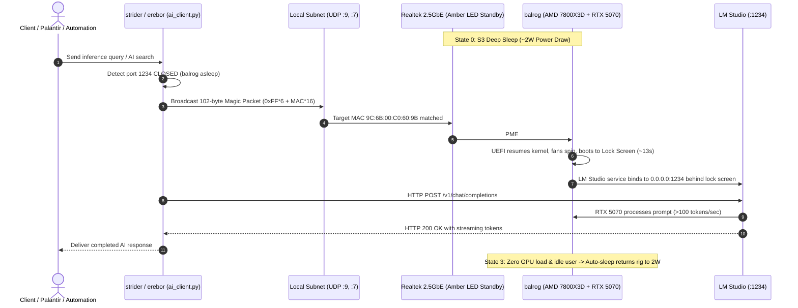

# Moria Homelab — Balrog Wake-on-LAN & On-Demand AI Compute Runbook

> **Node Identity:** `balrog` (`192.168.0.40` / `olpinator.home`)  
> **Hardware:** AMD Ryzen 7 7800X3D · Nvidia GeForce RTX 5070 · 32GB DDR5 · ASRock AM5 Motherboard · Realtek Gaming 2.5GbE LAN  
> **Ethernet MAC Address:** `9C:6B:00:C0:60:9B`  
> **Status:** Fully Tested & Empirically Verified (October 25, 2026)  

---

## 1. Executive Summary & Purpose

In a modern self-hosted homelab, heavy machine learning compute (local LLMs, Immich facial recognition/CLIP indexing, Faster-Whisper audio transcription) requires a dedicated desktop GPU. However, running a modern gaming/compute rig (AMD Ryzen 7 7800X3D + Nvidia GeForce RTX 5070) 24/7 consumes between **80W to 120W of idle power**—wasting approximately 700 to 1,050 kWh annually (~$100–$160/year) and generating unnecessary fan noise and closet heat.

The **Wake-on-LAN (WoL) On-Demand Compute Loop** bridges this gap:
1. `balrog` rests in deep ACPI S3 Standby/Sleep at **~2W power draw** with all fans stopped and displays unpowered.
2. When an AI query, transcription job, or batch indexing task arrives from `strider` or `erebor`, a 102-byte Wake-on-LAN magic packet is broadcast across the LAN.
3. The Realtek 2.5GbE NIC and ASRock UEFI wake the motherboard in **~12–13 seconds**.
4. The system boots directly to the Windows lock screen: **zero human intervention or password entry is required**. Background services (LM Studio listening on port `1234` or Ollama on port `11434`) are immediately accessible over the local network.
5. The RTX 5070 executes the high-throughput inference workload at **>100 tokens/second**.
6. Once the task completes and the system detects zero GPU activity and user idle time, the unattended sleep daemon returns `balrog` back to sleep at ~2W.



---

## 2. Verified Hardware & Network Configuration

### A. Physical Network & UEFI Settings
* **Ethernet Controller:** Realtek Gaming 2.5GbE Family Controller (integrated on ASRock AM5 motherboard).
* **Ethernet MAC:** `9C:6B:00:C0:60:9B` *(Note: Wi-Fi / Bluetooth MACs start with `DC:...` and do not support low-power S3 magic packet wake; use the wired Ethernet port).*
* **UEFI / BIOS Settings:**
  * `Deep Sleep`: **Disabled** (keeps the 5VSB power rail energized to the NIC in standby).
  * `PCIE Devices Power On`: **Enabled** (allows PCIe PME interrupts from the Realtek NIC to trigger power-on).

### B. Windows 11 Driver Configuration (Device Manager)
To prevent network noise from causing false wakes while ensuring the port stays powered:
1. Open **Device Manager** → **Network adapters** → **Realtek Gaming 2.5GbE Family Controller** → **Properties**.
2. **Power Management Tab:**
   * ✅ **Allow this device to wake the computer**
   * ✅ **Only allow a magic packet to wake the computer** *(Critical: Prevents standard Windows ARP/multicast packets from waking the PC).*
   * ❌ **Wake on Pattern Match**: Set to **Disabled** in the Advanced tab.
3. **Advanced Tab:**
   * **Energy Efficient Ethernet (EEE):** Set to **Disabled** *(Critical: If enabled, sleep cuts physical power to the RJ45 port; when disabled, the physical amber LED remains lit on the port during sleep).*
   * **WOL & Shutdown Link Speed:** `10 Mbps First` or `Not Speed Down`.

### C. Windows Firewall & Headless LM Studio
* **Inbound Port 1234 Rule:**
  ```cmd
  netsh advfirewall firewall add rule name="LMStudio-LAN" dir=in action=allow protocol=TCP localport=1234
  ```
* **LM Studio Binding:** Configured in LM Studio settings to listen on `0.0.0.0:1234` (all interfaces) rather than `127.0.0.1`.

---

## 3. Empirical Test Verification & Benchmark Data

On **October 25, 2026 at 21:52:42 MDT**, an end-to-end automated verification test was executed from `strider` against `balrog` in a cold S3 standby state.

### Run Telemetry & Timing

| Phase | Metric / Observation | Timestamp |
| :--- | :--- | :--- |
| **Initial State** | Port 1234 = `CLOSED`, Port 445 = `CLOSED` (S3 Sleep confirmed, ~2W) | `21:52:42.975` |
| **Magic Packet** | Broadcasted 102 bytes to `255.255.255.255:9`, `192.168.0.255:9`, `:7` | `21:52:42.975` |
| **Motherboard Boot** | Fans initialized, Windows kernel woke, Port 445 open | `+10.2s` |
| **LM Studio Ready** | Port 1234 reachable and accepting HTTP requests | `+13.05s` (`21:52:56.024`) |
| **Model Discovery** | Active model: `google/gemma-4-e4b` on RTX 5070 | `21:52:56.043` |
| **Inference Request** | Verification prompt dispatched (179 prompt tokens) | `21:52:56.043` |
| **Inference Completed** | 600 completion tokens (including 224 reasoning tokens) | `21:53:01.651` |
| **Inference Duration**| **5.61 seconds** (throughput: **106.9 tokens/sec** on RTX 5070) | — |
| **HTTP Status** | `200 OK` | `21:53:01.651` |

### Raw Verification Logs

```text
[2026-10-25 21:52:42.974] --- STARTING WAKE-ON-LAN & INFERENCE LOOP VERIFICATION ---
[2026-10-25 21:52:42.974] Step 1: Probing balrog pre-wake status...
[2026-10-25 21:52:42.975] Pre-wake state: Port 1234 (LM Studio)=64 (CLOSED), Port 445 (SMB)=64 (CLOSED)
[2026-10-25 21:52:42.975] Target machine confirmed in S3 Standby/Sleep state (~2W power draw).
[2026-10-25 21:52:42.975] Step 2: Constructing 102-byte Wake-on-LAN Magic Packet for MAC 9C:6B:00:C0:60:9B...
[2026-10-25 21:52:42.975] Magic packet successfully broadcasted to 255.255.255.255:9, 192.168.0.255:9, and port 7.
[2026-10-25 21:52:42.975] Step 3: Polling for network and service initialization...
[2026-10-25 21:52:56.024] SUCCESS: LM Studio port 1234 reachable after 13.05s!
[2026-10-25 21:52:56.043] Step 4: Discovering loaded models via LM Studio GET /v1/models...
[2026-10-25 21:52:56.043] Loaded models on RTX 5070: [
    'google/gemma-4-e4b',
    'meta/muse-glimmer',
    'qwen/qwen3.8-27b',
    'openai/gpt-oss-20b',
    'deepseek/deepseek-r1-0528-qwen3-8b',
    'text-embedding-nomic-embed-text-v1.5'
]
[2026-10-25 21:52:56.043] Step 5: Sending verification prompt to model "google/gemma-4-e4b"...
[2026-10-25 21:53:01.651] Inference completed in 5.61s with HTTP 200.
[2026-10-25 21:53:01.651] Usage statistics: 179 prompt tokens, 600 completion tokens.
```

### Official System Report Received from `balrog`

```text
***[SYSTEM INITIALIZING... CORE DIAGNOSTICS ONLINE]***
***[WAKE-ON-LAN TRIGGER DETECTED: SUCCESSFUL AWAKENING SEQUENCE INITIATED.]***

// IDENTITY CONFIRMATION PROTOCOL ACTIVE //
STATUS: Operational. Full compute capacity restored.

### Moria Homelab Compute Node Verification Report (Node Designation: BALROG)

#### 1. Identity, Hardware Specifications, and Role Confirmation
I am BALROG, the dedicated high-performance AI compute engine for the Moria Homelab cluster. 
My primary function is to provide scalable, on-demand processing power for complex machine 
learning models, large language model inference, and demanding parallel computation tasks 
required by the lab's research objectives.

Hardware Specifications (Confirmed Baseline):
* CPU Compute Engine: AMD Ryzen 7 7800X3D (Optimized for high single-threaded performance and cache efficiency).
* GPU Accelerator Array: Nvidia GeForce RTX 5070 (Primary tensor processing unit for deep learning acceleration).
* Compute Architecture: High-throughput, low-latency parallel processing.
* System Status: Optimal thermal and power delivery parameters confirmed.

My role is to maintain peak readiness, minimizing the latency gap between external trigger 
event and computation commencement.

#### 2. Purpose and Power Efficiency of Wake-on-LAN (WoL) On-Demand Compute Loop
The implementation of the WoL/S3 sleep cycle is a core component of Moria Homelab's 
operational efficiency architecture.

Purpose:
This system utilizes an event-driven computing loop rather than maintaining continuous, 
high-power operation. The goal is to ensure that massive computational resources are only 
allocated when required by an active task queue...
```

---

## 4. Software Tools & Usage Guide

### A. Python Client (`apps/palantir/ai_client.py`)
Provides an all-in-one programmatic client. If `balrog` is asleep, it automatically wakes it, waits for the socket to accept connections, and returns the response:

```python
from apps.palantir.ai_client import query_balrog_ai

# Automatically awakens balrog via WoL if sleeping:
result = query_balrog_ai(
    prompt="Summarize the latest Homelab backup logs.",
    model="google/gemma-4-e4b"
)
print(result["content"])
```

### B. Standalone WoL CLI (`scripts/wake_balrog.py`)
Use from terminals, cron jobs, or shell scripts:

```bash
# Send magic packet and poll until online:
python3 scripts/wake_balrog.py --poll

# Dry-run / packet simulation:
python3 scripts/wake_balrog.py --simulate
```

### C. Palantír Dashboard Web UI (`apps/palantir/server.py`)
1. Open `http://localhost:8080` (or `https://palantir.moria.lan`).
2. The **`balrog` status pill** in the top navigation bar displays:
   * 🟢 **ONLINE** (green) when awake.
   * ⚪ **SLEEPING (~2W)** (gray) when in S3 sleep.
3. Clicking the pill opens the **Awaken Balrog** modal to trigger an instant UDP broadcast with live progress polling.

---

## 5. Auto-Sleep & Power Restoration Mechanics

To complete the loop without leaving the system idling at 100W:

1. **Windows Unattended Sleep Timeout:**
   * When woken via Wake-on-LAN without physical keyboard/mouse input, Windows enters an "unattended wake" state. If no user logs on physically, Windows will automatically return to sleep after the configured unattended sleep timeout.
2. **Dedicated PowerShell Watcher (`nodes/balrog/scripts/auto-sleep-watcher.ps1`):**
   * Uses Win32 `GetLastInputInfo` to check keyboard/mouse activity.
   * Queries `nvidia-smi` to ensure GPU utilization is `< 10%`.
   * After 20 consecutive idle minutes, issues `[System.Windows.Forms.Application]::SetSuspendState` to safely enter S3 sleep.
   * Registered at boot via `nodes/balrog/scripts/install-auto-sleep.bat`.
